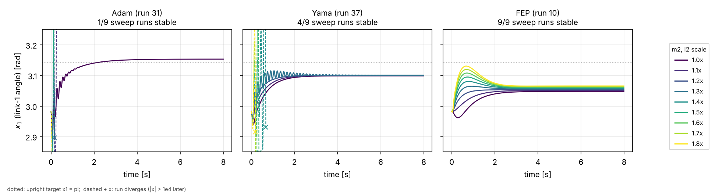

# Robust Neural Control via Flat Minima for Dynamical Systems — Pendubot

[](https://github.com/OmkarJ48/Robust-Neural-Control-Via-Flat-Minima-For-Dynamical-Systems-Using-Pendubot-Model/actions/workflows/verify.yml)
[](LICENSE)

MATLAB + CasADi code for my MSc dissertation (ME7743, MSc Mechatronic Systems, Kingston University London, 2025; supervisor Dr Olga Napolitano). The full report is in [docs/dissertation_report.pdf](docs/dissertation_report.pdf).

A small neural network balances a **Pendubot** (a two-link arm with one motor at the shoulder) in the upright position. The training pipeline tries to make the controller **robust to changes in the plant parameters** by penalising how sharply the closed-loop cost reacts to those parameters (a flat-minimum / flatness criterion). Three training dynamics are compared under the same simulator, horizon and cost: **Adam**, a **Yamashita-type projected flow ("Yama")** and the **null-space gradient flow of Feppon, Allaire and Dapogny ("FEP")**.



*Link-1 angle of the three reported controllers while link-2 mass and centre-of-mass distance are scaled together from 1.0x to 1.8x, on the plant the runs were trained on. Only FEP stays stable over the whole sweep. Regenerate with `python tools/reproduce_results.py`.*

> **Status.** The reported runs (10, 31 and 37) were produced by code with two plant-model bugs: a swapped parameter map and a scalar friction term. Both are fixed on `main` ([CHANGELOG](CHANGELOG.md)).
>
> - **Reproducing the dissertation:** use the Python tools, which reproduce MATLAB to about 1e-12, or commit [`d7dc4db`](#7-how-to-run), the code as it was used for the dissertation.
> - **On the corrected plant:** none of the stored controllers, not even the warm starts, is stable. Re-running the pipeline on the corrected plant (teaching by demonstration, then training) is the next step.

---

## Contents

1. [Aim and objectives](#1-aim-and-objectives)
2. [Problem set-up](#2-problem-set-up)
3. [Method](#3-method)
4. [Results](#4-results)
5. [Repository structure](#5-repository-structure)
6. [Setup](#6-setup)
7. [How to run](#7-how-to-run)
8. [Known limitations](#8-known-limitations)
9. [Notes for readers of the dissertation](#9-notes-for-readers-of-the-dissertation)
10. [References](#10-references)
11. [Author, licence and third-party code](#11-author-licence-and-third-party-code)

---

## 1. Aim and objectives

**Aim:** develop and evaluate a flat-minima-centred optimisation pipeline for robust Pendubot control.

| # | Objective | Where it lives in this repository |
|---|---|---|
| 1 | Integrate a CasADi differentiable simulator with a neural policy and a flatness regulariser | `src/integra.m`, `src/costAndDerBuilder.m`, `src/flatnessBuilder.m`, `src/+controller/neuralController.m` |
| 2 | Implement and compare Adam, Yama and FEP training dynamics | `src/+optim/adamOptimizer.m`, `src/+optim/yamaOptimizer.m`, `src/+optim/fepOptimizer.m`, runs 31, 37 and 10 |
| 3 | Quantify settling time (Ts) and overshoot (%OS), and analyse robustness | [Section 4](#4-results), `tools/` |
| 4 | Identify failure modes and propose mitigations | [Section 4.4](#44-interpretation), [Section 8](#8-known-limitations), [CHANGELOG](CHANGELOG.md) |

Scope: simulation only, one actuator, no hardware-in-the-loop and no sensor delays.

---

## 2. Problem set-up

### 2.1 Plant

State `x = [q1, q2, q1_dot, q2_dot]`. `q1` is measured from the downward vertical and `q2` relative to link 1, so the upright target is `x_des = [pi, 0, 0, 0]`. The input is the shoulder torque `u1`. The dynamics in `src/+model/Pendubot.m` follow Lanari and Oriolo:

```
M(q) q_ddot + C(q, q_dot) q_dot + G(q) = [u1; 0] - diag(mu1, mu2) q_dot
```

with `I_i = m_i a_i^2 / 12` (slender links), `a_i` the link length, `l_i` the joint-to-centre-of-mass distance and g = 9.8 m/s^2.

| Parameter | Current code (`test_drive/PendubotModelConf.m`) | Used by runs 10, 31, 37 |
|---|---|---|
| m1 (link-1 mass) | 0.193 kg | 0.1032 |
| l1 (link-1 CoM distance) | 0.1032 m | 0.193 |
| m2 (link-2 mass, **uncertain**) | 0.073 kg | 0.1065 |
| l2 (link-2 CoM distance, **uncertain**) | 0.1065 m | 0.073 |
| a1, a2 (link lengths) | 0.1483 m, 0.1804 m | same |
| mu1, mu2 (viscous friction) | 0.01, 0.01 per joint | `[mu1; mu2]' q_dot`, one scalar on both joint equations |

Simulation: explicit Euler, `DT = 0.01 s`, `N = 800` steps (8 s), initial state `xInit = [2.98, 0.1, 0.3, 0.3]`.

### 2.2 Cost

Running and terminal cost, from `test_drive/PendubotModelConf.m` (also used by runs 31 and 37):

```
L       = 100 (x2_n - x2_n,des)^2 + 100 (x1 - pi)^2 + 0.001 u1^2
L_final = 500 [ (x2_n - x2_n,des)^2 + (x1 - pi)^2 + x3^2 + x4^2 ]
x2_n    = 2 (x2 + pi) / (3 pi) - 1
```

Run 10 used the raw angle `x2` in place of `x2_n` (see `results/10/PendubotModelConf.m`), so J values cannot be compared across runs.

### 2.3 Controller

`src/+controller/neuralController.m`: a 4-10-1 network, `u = W2' tanh(W1' x + b1) + b2`, with 61 parameters. The output is de-normalised to the range of the teacher torques stored in `normalization_data.mat`: `tau = (y + 1)/2 (max - min) + min`. Input normalisation is off.

### 2.4 Uncertainty and robustness test

The uncertain parameters are `v = [m2, l2]`. `src/visualization.m` re-simulates the trained controller nine times, scaling **both** parameters by 1.0, 1.1, …, 1.8 (nominal to +80 %). The rollouts are deterministic, because the noise covariance is zero.

---

## 3. Method

### 3.1 Flatness measure

`src/flatnessBuilder.m` measures how sensitive the total rollout cost `J(v, theta)` is to the **plant parameters** `v`, using CasADi's exact gradient and Hessian:

```
'2order'    : B(theta) = log( 1/2 (1 + ||grad_v J||^2) + (trace hess_v J)^2 )      <- used in all runs
'1orderStd' : B(theta) = -log( (sqrt(eps)/n)^n / (sum_i |dJ/dv_i| + damping) )      (eps = epsilon_flat, n = dim v)
```

A small B means the cost is locally insensitive to `m2` and `l2`. Optimisers that use flatness need `grad_theta B`, which CasADi differentiates through the whole 800-step rollout. `epsilon_flat` and `dumping` only enter the `'1orderStd'` variant.

### 3.2 Pipeline

1. **Warm start by teaching by demonstration** (`scripts/mainTeachingByDemonstration.m`). An LQR teacher (`src/+controller/lqrController.m`, Q = diag(5, 5, 0.5, 0.5), R = 20, linearised at the upright point, torque limited to ±0.5 N m) produces one nominal trajectory and 19 copies whose states are perturbed with Gaussian noise (Sigma = I). The network is fitted to the teacher torques with mini-batch Adam (MSE). This writes `normalization_data.mat` and `optimal_param_teaching.mat`.
2. **Training** (`scripts/main.m`, `flag_mode = 0`). The rollout cost J and flatness B are built symbolically. Then the optimiser selected by `optimization_type` in `experimentEnvOptConf.m` runs, and each run is saved to `results/<n>/`.
3. **Testing** (`scripts/main.m`, `flag_mode = 1`). The weights in `results/<folder_number>/optimal_param.mat` are loaded, and `src/visualization.m` plots the nominal run and the nine-point sweep.

### 3.3 Optimisers (`src/+optim/`)

| `optimization_type` | Class | What the update does |
|---|---|---|
| 0 | `adamOptimizer` | Teaching by demonstration: mini-batch Adam on the MSE to the teacher torques |
| 1 | `adamOptimizer` | Adam on `grad_theta J` only. B is logged but not used. |
| 2 | `yamaOptimizer` | Two-level task priority (Yamashita-style flow). The primary task drives `J -> J_val_des` at rate `alpha_F`. The secondary task drives `B -> B_val_des` at rate `alpha_B` in the null space of `grad J`. Fixed Euler step. |
| 3 | `ipoptOptimizer` | IPOPT on `0.001 (J - J_val_des)^2 + B` |
| 4 | `yamaAdaGradOptimizer` | Same direction as type 2, scaled by a single RMS-normalised step |
| 5 | `fepOptimizer` | MATLAB port of Feppon's null-space optimiser: **minimise B subject to J <= J_val_des**. A qpOASES dual QP selects the active constraints. The update combines a null-space step on B with a Gauss-Newton range step on the constraint, and backtracks on a merit function (up to 100 halvings). `alpha_F`, `alpha_B` and `B_val_des` are not used. |

---

## 4. Results

All numbers in this section come from the stored runs, re-simulated with `tools/pendubot_sim.py`, and are checked on every push by `tools/selftest.py`.

### 4.1 Reported runs

| Run | Method | Saved | Iterations | Main settings | J (first -> last) | B (first -> last) |
|---|---|---|---|---|---|---|
| `results/10` | FEP (type 5) | 18 Jul 2025 | 100 | step 1e-4, `J_val_des` = 10, one inequality, no noise | 12 482 -> 507 (-96 %) | 422.8 -> 309.0 (-27 %) |
| `results/31` | Adam (type 1) | 26 Jul 2025 | 1500 | step 5e-6, beta1 0.95, beta2 0.999, state noise sigma 1e-3 | 6 137 -> 161 (-97 %) | 27.0 -> 30.1 (+12 %) |
| `results/37` | Yama (type 2) | 23 Aug 2025 | 1000 | step 1e-5, alpha_F 0.9, alpha_B 0.999, `J_val_des` 5, `B_val_des` -120, sigma 1e-3 | 348 -> 373 (+7 %) | 25.9 -> 24.9 (-4 %) |

Each folder holds:
- `init_param.mat`, `optimal_param.mat`, `param_stack.mat`, `J_stack.mat` and `B_stack.mat`;
- copies of `main.m`, `experimentEnvOptConf.m`, `PendubotModelConf.m` and `neuralControllerConf.m` as they were at run time;
- for runs 31 and 37, the nominal rollout `x_stack.mat` / `u_stack.mat`;
- `normalization_data.mat`, recovered afterwards (see [4.5](#45-how-these-numbers-were-obtained)).

Runs 10 and 31 start from the same warm start; run 37 starts from a later, regenerated one. FEP never reaches its constraint (J ends at 507 against `J_val_des` = 10), so its range step is active throughout the run.

### 4.2 Robustness and transient metrics

On the plant the runs were trained on (`--plant as-run`, the default). Nominal values are at 1.0x, and each controller uses the torque normalisation it was trained with.

| Controller | Weights | Stable sweep runs | Stable up to | Nominal pi − x1 [rad] | Ts [s] | %OS | RMS(u) [N m] | max abs u [N m] |
|---|---|---|---|---|---|---|---|---|
| Adam (run 31) | warm start | 9/9 | +80 % | +0.294 | 3.62 | 0.0 | 0.096 | 0.102 |
| Adam (run 31) | **trained** | **1/9** | +0 % | −0.012 | 3.28 | 0.0 | 0.072 | 0.721 |
| Yama (run 37) | warm start | 9/9 | +80 % | +0.040 | 1.97 | 3.9 | 0.023 | 0.154 |
| Yama (run 37) | **trained** | **4/9** | +30 % | +0.043 | 2.46 | 0.0 | 0.025 | 0.174 |
| FEP (run 10) | warm start | 9/9 | +80 % | +0.349 | 2.82 | 0.0 | 0.114 | 0.120 |
| FEP (run 10) | **trained** | **9/9** | **+80 %** | +0.093 | 3.22 | 0.0 | 0.038 | 0.103 |

- **Ts** is the time after which x1 stays within 2 % of the step size `|x1(8 s) − x1(0)|` (floor 1e-3 rad).
- **%OS** is the peak of x1 beyond its final value, as a percentage of the step size.
- A run counts as **diverged** if any state exceeds 1e4, the same test as `src/visualizationAux.m`.
- **On the corrected plant** (`--plant corrected`, the current code), every controller in the table diverges at 1.0x, including the warm starts. With only the parameter map corrected and the old scalar friction kept, the trained FEP controller would still be stable up to +60 % (7/9), while trained Adam and Yama would diverge. The friction term is therefore what the stored controllers depend on most.

### 4.3 What the committed figures show

The `.fig` files in `docs/figures/matlab/` were identified by re-simulation. Each one below matches exactly one run to between about 1e-13 and 1e-10.

| File(s) | Content |
|---|---|
| `Optimization_1.fig`, `Testing_1.fig` | Run 10 (FEP), nominal |
| `Optimization_2.fig`, `Testing_2.fig` | Run 10 (FEP), sweep |
| `Adam_optimization_3.fig` | Run 37 (**Yama**) sweep. The file name is misleading. |
| `Yama_optimization_1.fig` | Run 37 live training plot (J, B, orthogonality, gradient norms) |
| `Yama_optimization_2.fig` | Run 37, nominal |
| `Yama_testing_1.fig`, `Yama_testing_2.fig` | Run 37 nominal and sweep, re-tested after `normalization_data.mat` was regenerated |
| `Teacher_controller_optimized.fig` | LQR teacher rollout on the as-run plant (K = [−12.65, −12.21, −1.34, −0.76]) |
| `Teacher_controller_tested.fig` | Perturbed training trajectory 6: the teacher trajectory plus N(0, 1) state noise. It is not a test rollout. |
| `Student_controller_optimization.fig`, `Student_controller_tested.fig` | Network fitted by teaching by demonstration on 26 Jul 2025. It diverges from the first step. Its weights were overwritten later, so it cannot be re-simulated. |
| `Performance_CostJ_Stack.fig`, `Flatness_Regularization_B_Stack.fig` | J and B history of a 1500-iteration run. It is not run 31, whose values differ; Adam is the only reported config with 1500 iterations. |
| `docs/data/x_stack.mat`, `u_stack.mat` | Run 31 nominal, re-tested on 4 Sep 2025 with the 23 Aug normalisation (the dissertation's "Adam training" figure) |

### 4.4 Interpretation

- The LQR-taught **warm starts are already robust** on the as-run plant (9/9 stable), but runs 10 and 31 start about 0.3 rad short of upright.
- **FEP is the only optimiser that improved tracking without losing robustness.** It cut the nominal offset by 73 % (0.349 -> 0.093 rad), reduced B by 27 % and stayed stable over the whole sweep. This is consistent with its objective: it minimises B, the sensitivity of the cost to m2 and l2, within a performance budget.
- **Adam (performance only) reached the target** but lost almost all robustness: only the nominal case is stable.
- **Yama made run 37 slightly worse.** J rose by 7 %, B fell by only 4 %, and the stable range shrank from +80 % to +30 %.
- All three optimisers changed the weights only slightly: the largest single change was 6e-4 for FEP, 2e-3 for Adam and 1e-3 for Yama. The behaviour still changed a lot because the output scaling turns one unit of network output into about 70–100 N m of torque, while about 0.02 N m holds the arm upright. The cause was unsaturated teacher torques in the warm-start data, fixed for future warm starts ([CHANGELOG](CHANGELOG.md)).
- Every run settles with `x1 + x2 = pi`. Link 2 is exactly vertical and link 1 sits slightly off upright with a small holding torque: a forced equilibrium rather than the target. The cost has no integral action to remove this offset.
- The robustness demonstrated here is robustness on the plant model that was simulated. Once the two plant bugs are corrected, no stored controller works, so the comparison has to be repeated on the corrected plant before any conclusion about the physical Pendubot.

### 4.5 How these numbers were obtained

`tools/pendubot_sim.py` re-implements the closed loop in NumPy, including the dynamics, Euler integration, network, de-normalisation and sweep. It reproduces MATLAB to round-off error:

- run 31 matches `docs/data/x_stack.mat` to 4e-13;
- runs 31 and 37 match their own `x_stack.mat` to 1e-12;
- run 10 matches `Testing_2.fig` to 5e-13;
- the LQR teacher matches `Teacher_controller_optimized.fig` to 1e-10.

`normalization_data.mat` was regenerated several times and was not saved per run (it is now; see the CHANGELOG). The range each controller was trained with was therefore recovered by least squares from MATLAB's own saved rollouts (residual about 1e-13) and stored as `results/<n>/normalization_data.mat`:

| Controller | Torque range | Source |
|---|---|---|
| Run 31 | [−103.145, 95.141] N m | `results/31/x_stack.mat`, `u_stack.mat` |
| Run 37 | [−74.361, 68.698] N m | `results/37/x_stack.mat`, `u_stack.mat` |
| Run 10 | [−74.361, 68.698] N m | Inferred: no rollout is stored in the folder, and all saved run-10 figures use this range |
| `test_drive/normalization_data.mat` | [−69.387, 64.064] N m | Current file (23 Aug 2025) |

`python tools/reproduce_results.py` prints the full tables, including the rows for the current normalisation file. `python tools/reproduce_results.py --plant corrected` prints the same tables for the current code.

---

## 5. Repository structure

```
.
├── scripts/                          # entry points - run these
│   ├── main.m                        # train (flag_mode = 0) or test (flag_mode = 1) a controller
│   └── mainTeachingByDemonstration.m # LQR teacher -> warm-start network
├── src/                              # library code (added to the MATLAB path by the scripts)
│   ├── integra.m, costAndDerBuilder.m, costAndDerBuilderTeaching.m, flatnessBuilder.m
│   ├── perturbedTrajectoriesTbD.m, visualization.m, visualizationAux.m
│   ├── globalNormalize.m, creatingGridBoundUncertainVariable.m
│   ├── +controller/                  # neural, LQR, PID and dummy controllers
│   ├── +model/                       # Pendubot and example models, URDF wrapper (+ urdf/)
│   ├── +optim/                       # adam, yama, yamaAdaGrad, ipopt, fep optimisers
│   └── examples/                     # configs for the example models
├── robotics_result/robust_optimization/test_drive/
│   ├── experimentEnvOptConf.m        # horizon, flatness and optimiser settings
│   ├── PendubotModelConf.m           # Pendubot experiment config (used by main.m)
│   ├── neuralControllerConf.m        # 4-10-1 network config
│   ├── cartPoleModelConf.m
│   ├── normalization_data.mat        # teacher torque range (output de-normalisation)
│   ├── optimal_param_teaching.mat    # warm-start weights
│   └── results/{10,31,37}/           # the three reported runs (others are git-ignored)
├── config_templates/                 # older generic configs, kept off the MATLAB path
├── docs/
│   ├── dissertation_report.pdf       # the MSc dissertation (43 pages)
│   ├── CODE_OVERVIEW.md              # file-by-file reference
│   ├── figures/                      # README figure + original MATLAB .fig files
│   ├── data/                         # x_stack.mat / u_stack.mat (run 31 nominal test)
│   └── configs/                      # adam/fep blocks of the run-37 config
├── tools/                            # Python: .fig reader, re-simulation, results, self-test
├── .github/workflows/verify.yml      # runs tools/selftest.py on every push
├── CHANGELOG.md, CITATION.cff, LICENSE
└── requirements.txt                  # Python packages for tools/ + MATLAB toolbox list
```

No MATLAB code sits in the repository root. The scripts add `src/`, `src/examples/` and `test_drive/` to the MATLAB path themselves, with `test_drive/` added last so its configs take precedence. `config_templates/` is deliberately kept off the path: its older `PendubotModelConf.m` and cart-pole `neuralControllerConf.m` would otherwise replace the experiment versions. See [docs/CODE_OVERVIEW.md](docs/CODE_OVERVIEW.md) for every file.

---

## 6. Setup

1. **MATLAB R2024b.** This is the release that saved the committed figures; other recent releases should work but are untested. Toolboxes:
   - **Statistics and Machine Learning Toolbox**: `mvnrnd` is called in every rollout.
   - **Control System Toolbox**: `lqr`, needed only for teaching by demonstration.
2. **CasADi 3.7.0 for MATLAB** (the runs used `casadi-3.7.0-windows64-matlab2018b`). Download it from <https://web.casadi.org/get/> and unzip it outside the repository. The bundled IPOPT and qpOASES plugins are needed for `optimization_type` 3 and 5.
3. **Point the scripts to CasADi.** The `addpath(...)` line near the top of `scripts/main.m` (line 7) and `scripts/mainTeachingByDemonstration.m` (line 8) holds a hard-coded `D:\...` path; change it to your CasADi folder.
4. **Optional, for `tools/`:** Python 3.10 or newer, then:

```bash
pip install -r requirements.txt
```

The example models in `src/+model/` (Puma 560, URDF wrapper, iDynTree test) need extra toolboxes, listed in `requirements.txt`. The Pendubot experiments do not use them.

---

## 7. How to run

Open the scripts in `scripts/` and run them from the **MATLAB Editor** with the script as the active tab. They find the repository from their own location, so the current folder does not matter. The Editor is needed because `experimentEnvOptConf.m` records `matlab.desktop.editor.getActiveFilename`, and `main.m` copies that file into the results folder.

**Run the pipeline on the corrected plant (current `main`)**

1. **Warm start.** Run `scripts/mainTeachingByDemonstration.m` with `flag_mode = 0` (line 17). This overwrites `test_drive/normalization_data.mat` and `optimal_param_teaching.mat`; the committed ones were made on the old plant. The LQR teacher is verified to stabilise the corrected plant.
2. **Train.** In `test_drive/experimentEnvOptConf.m`, choose `optimization_type` (1 Adam, 2 Yama, 3 IPOPT, 4 YamaAdaGrad, 5 FEP) and its settings. In `scripts/main.m`, set `flag_mode = 0` (line 21) and keep `load_random_predefined_init_point = 'load'` and `result_from_teaching = 1`. Run it. The results go to the next free `results/<n>/` folder, together with the configs and `normalization_data.mat`.
3. **Test.** In `scripts/main.m`, set `flag_mode = 1` and `folder_number` (line 164), then run it. This plots the nominal run and the 1.0x–1.8x sweep.

**Reproduce the dissertation runs in MATLAB**

```bash
git checkout d7dc4db
```

Commit `d7dc4db` is the code as it was used for the dissertation (reorganised into `scripts/` and `src/`, nothing else changed), listed as 1.0.0 in the [CHANGELOG](CHANGELOG.md). Before re-testing run `<n>` there:

1. Copy `results/<n>/normalization_data.mat` from `main` over `test_drive/normalization_data.mat`.
2. For run 10, also copy `results/10/PendubotModelConf.m` over `test_drive/PendubotModelConf.m`. This only changes the cost, not the plotted trajectories.
3. Set `flag_mode = 1` and `folder_number` in `scripts/main.m`.

`results/37/optimal_param.mat` stores a `casadi.DM`, so CasADi must be on the path to load it.

**Without MATLAB**

```bash
python tools/reproduce_results.py
```

```bash
python tools/reproduce_results.py --plant corrected --no-plot
```

```bash
python tools/selftest.py
```

```bash
python tools/fig_metrics.py docs/figures/matlab/Testing_2.fig
```

---

## 8. Known limitations

The bugs found while documenting the code are fixed on `main` and listed in the [CHANGELOG](CHANGELOG.md). The points below are deliberate choices or untested extras.

1. **Cost scaling of x2.** `x2_n = 2 (x2 + pi) / (3 pi) - 1` uses a range of 3π. It only rescales the weight on x2 and is kept as used.
2. **No integral action.** The trained controllers settle at a forced equilibrium slightly off upright ([4.4](#44-interpretation)).
3. **Single robustness direction.** The sweep scales m2 and l2 together, up to +80 % only, without noise or sensor models.
4. **Integral flatness is not available.** `type_of_flat.integral = true` now stops with an error, because the optimisers do not pass the Monte Carlo samples correctly.
5. **Parameter-landscape plots in `src/visualization.m` stay disabled.** The cost and flatness history plots now appear after training, but the landscape frames call `funJ` without its noise argument and would need rework.
6. **Windows-centric code.** Several files join paths with `'\'`, and the CasADi path must be edited by hand (Setup, step 3).
7. **Example and legacy models are not maintained.**
   - `PIDLinearizedController` does not fit the single-input Pendubot.
   - `robotRobTolBox.m` / `robotRobTolBoxConf.m` are incomplete.
   - `kuka_lwr_payload*.urdf` contain unexpanded xacro expressions.
   - The URDF and Puma examples need the extra toolboxes listed in `requirements.txt`.
8. **MATLAB was not available while the fixes were made.** The changes in the CHANGELOG are small and were checked by re-simulating in Python and by static analysis, but they have not been run in MATLAB.

---

## 9. Notes for readers of the dissertation

The report is in [docs/dissertation_report.pdf](docs/dissertation_report.pdf). It was converted from the submitted Word file with LibreOffice, so its fonts are metric-compatible substitutes (Liberation Serif for Times New Roman). Four positive-part symbols written as a trailing `g+`, and one literal backslash in an equation, were adjusted so that LibreOffice Math renders them; the text is otherwise unchanged.

Re-analysing the saved code and data refines a few statements in the report:

| Topic | Report | Code and data |
|---|---|---|
| Plant | Lanari–Oriolo parameters | Runs used m1 ↔ l1 and m2 ↔ l2 swapped, and scalar friction (now fixed) |
| Robustness test | 13 parameters varied by ±5–20 %, five seeds per point | 2 parameters (m2, l2) scaled together from 1.0x to 1.8x, deterministic |
| Flatness measure | Hessian–vector probes in weight space | Exact gradient and Hessian trace of J with respect to the plant parameters v |
| Yama | Descent on a combined merit `alpha_F J + alpha_B B` | Task priority: J -> `J_val_des` first, B -> `B_val_des` in the null space |
| FEP | Combined merit with `alpha_F` = 1000, `alpha_B` = 1; line search proposed as future work | Minimises B subject to J <= `J_val_des`; `alpha_F` and `alpha_B` unused; merit backtracking already implemented |
| FEP testing | Some runs diverge (states up to 1e280) | Trained FEP controller stable in all 9 sweep runs (`Testing_2.fig`) |
| Adam testing | Fails to settle under parameter variation | Stable at nominal only (1/9) |
| Yama | Fastest settling, lowest control bias | Fastest Ts and lowest RMS(u) of the three, but stable only up to +30 %, and its training slightly increased J |

The report's settling band (2 % of `|x1,inf|`, about 0.06 rad) is larger than half of the roughly 0.1 rad step, which is why section 4 measures the band relative to the step instead.

---

## 10. References

- Hochreiter, S. and Schmidhuber, J. (1994) *Flat Minimum Search Finds Simple Nets*. Technical Report FKI-200-94, TU München.
- Yamashita, H. (1980) 'A differential equation approach to nonlinear programming', *Mathematical Programming*, 18, pp. 155–168.
- Feppon, F., Allaire, G. and Dapogny, C. (2020) 'Null space gradient flows for constrained optimization with applications to shape optimization', *ESAIM: COCV*, 26, 90. doi:10.1051/cocv/2020015
- Nogueira, J., Martinez-Cantin, R., Bernardino, A. and Jamone, L. (2016) 'Unscented Bayesian Optimization for Safe Robot Grasping', arXiv:1603.02038.
- Lanari, L. and Oriolo, G. (n.d.) *The Pendubot*. Technical note.
- Spong, M.W. and Block, D.J. (1995) 'The Pendubot: a mechatronic system for control research and education', *Proc. 34th IEEE CDC*, pp. 555–556.
- Li Noce, A., Patanè, L. and Arena, P. (2025) 'A stable and safe method for two-leg balancing of a quadruped robot using a neural-network-based controller', *Robotics and Autonomous Systems*, 186, 104901.
- Andersson, J.A.E. et al. (2019) 'CasADi: a software framework for nonlinear optimization and optimal control', *Mathematical Programming Computation*, 11, pp. 1–36.
- Kingma, D.P. and Ba, J. (2015) 'Adam: a method for stochastic optimization', arXiv:1412.6980.
- Dorato, P. (1987) 'A historical review of robust control', *IEEE Control Systems Magazine*, 7(2), pp. 44–47.

---

## 11. Author, licence and third-party code

**Author:** Omkar Anant Joshi, MSc Mechatronic Systems, Kingston University London. Supervisor: Dr Olga Napolitano. To cite this repository, use [CITATION.cff](CITATION.cff) (GitHub's "Cite this repository" button).

**Licence:** [GNU General Public License v3.0](LICENSE). © 2025 Omkar Anant Joshi. The licence was chosen to match the GPL-3.0 null-space optimiser that `fepOptimizer.m` is ported from.

**Third-party material** keeps its original terms:

- `src/+optim/fepOptimizer.m`: MATLAB port of Florian Feppon's null-space optimiser (<https://gitlab.com/florian.feppon/null-space-optimizer>, GPL-3.0 according to its PyPI package `nullspace-optimizer`).
- `src/+model/mdlPuma.m`: Puma 560 model from Peter Corke's Robotics Toolbox for MATLAB (LGPL-3.0, see the file header).
- `src/+model/urdf2casadiWrapper.m`: its forward-dynamics routine is taken from urdf2casadi's `symbolicForwardDynamics()` (see the comment in the file).
- `src/+model/urdf/kuka_kr210*.urdf`: generated from ROS-Industrial's `kuka_experimental` package; `kuka_lwr*.urdf` from an `lwr_description` package.
